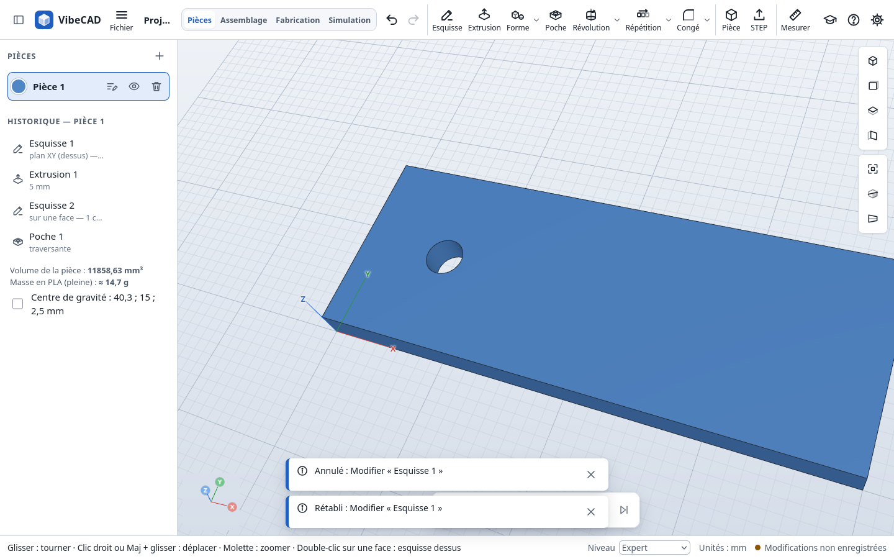
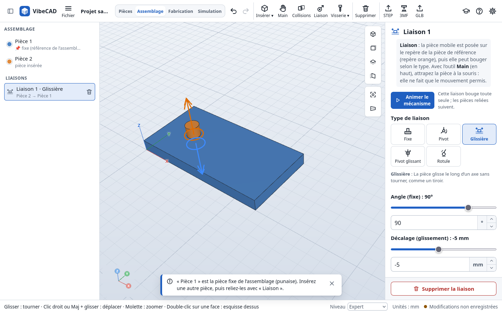
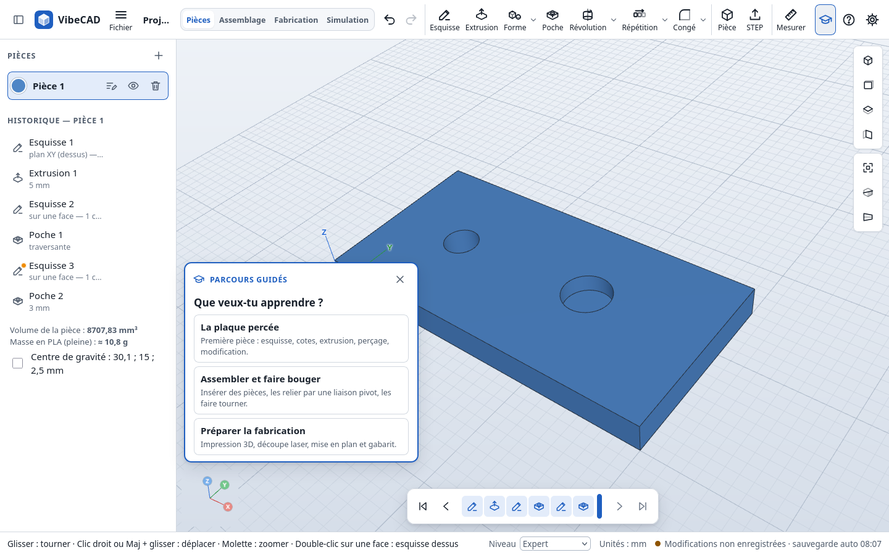

# VibeCAD — CAO 3D paramétrique pour apprendre

VibeCAD est un petit logiciel de **CAO 3D paramétrique** qui fonctionne entièrement dans le
navigateur. Il est conçu pour apprendre les bases réelles de la conception mécanique — choisir un
plan, dessiner une esquisse cotée, créer un volume, retirer de la matière, modifier une étape
antérieure — avec une interface sérieuse mais rassurante, en français.

Le résultat se reprend dans **FreeCAD** grâce à l'export **STEP** (solides exacts, en
millimètres, avec le nom et la couleur de chaque pièce).

> Les fichiers de projet gardent l'extension `.vibecad` (nom de développement de l'application) :
> les projets déjà enregistrés s'ouvrent sans conversion ([décision 0007](docs/decisions/0007-nom-application.md)).







## Ce que l'on peut faire

- **Projets** : nouveau, ouvrir, enregistrer (dans le navigateur), enregistrer sous (fichier
  `.vibecad`), sauvegarde automatique et récupération après fermeture inattendue.
- **Pièces** : une ou plusieurs pièces indépendantes dans un document ; nom, visibilité, couleur.
- **Esquisses** sur les plans XY, XZ, YZ ou sur une face plane : segment, rectangle (par deux
  coins ou par le centre, qui reste au milieu quand on cote), cercle, **arc de cercle** (centre,
  départ, arrivée ; les contours mêlant segments et arcs donnent de vrais volumes), **polygone
  régulier** (centre et sommet, 3 à 32 côtés, inscrit dans un cercle de construction qu'on cote),
  **oblong** (rainure : deux centres et une largeur) ;
  sélection, déplacement, suppression ; accrochage à l'origine, aux points et à la grille avec
  repères visuels et textuels. Outil **Couper** (T) : retirer le morceau d'un trait jusqu'aux
  croisements voisins (le morceau est montré en rouge au survol), pour réunir deux formes en un
  seul contour ; les nouvelles extrémités restent posées sur le trait qui coupe.
- **Cotes** : longueur, diamètre, rayon, distances horizontale / verticale / alignée, distance
  d'un point à un segment ou entre segments parallèles, **angle** entre deux segments. Les deux
  éléments se cliquent l'un après l'autre. Saisie au clavier (virgule décimale acceptée), petites
  flèches ▲▼ ou molette de la souris (Maj : ×10, Alt : ×0,1) dans tous les champs de valeur.
- **Contraintes** : coïncidence, horizontal, vertical, parallèle, perpendiculaire, égalité,
  colinéaire, tangence, point sur une courbe, milieu, concentrique ; par clics successifs ou sur
  la sélection. Affichage du nombre de degrés de liberté (vert = entièrement contraint).
- **Construction et projection** : traits de construction (pointillés, ignorés pour le volume) ;
  arêtes de la pièce **projetées** dans l'esquisse (bord, trou…) comme repères fixes qui suivent
  la pièce quand elle change.
- **Volumes** : extrusion et poche (profondeur cotée ou traversante, sens normal / opposé /
  symétrique) avec **aperçu** avant validation. Un perçage est une poche circulaire traversante.
- **Révolution** : faire tourner un profil autour d'un axe de l'esquisse (axe X, Y ou un segment,
  souvent de construction), tour complet ou partiel, avec aperçu.
- **Formes toutes faites** : boîte, cylindre, boule et anneau, placées par leurs coordonnées,
  ajoutées à la pièce ou creusées dedans (comme un trou), sans passer par une esquisse.
- **Répétition** d'une extrusion, d'une poche (un trou…) ou d'une révolution : en ligne, en
  grille (deux directions) ou en cercle, le long d'un axe X / Y / Z ou d'une arête cliquée (bord
  droit, ou bord d'un trou pour tourner autour de son axe), avec aperçu.
- **Symétrie** : ajouter le reflet de toute la pièce, ou d'une seule étape (un trou, un plot…),
  par rapport au plan XY, XZ, YZ ou à une face plane cliquée.
- **Coque** : vider la pièce en gardant une paroi d'épaisseur choisie (vers l'intérieur ou
  l'extérieur), en cliquant les faces à laisser ouvertes (un pot, une boîte) ; sans face ouverte, la
  pièce est creuse et fermée.
- **Congés et chanfreins** sur des arêtes choisies à la souris, avec aperçu ; les arêtes sont
  mémorisées par leurs deux faces voisines et survivent aux modifications des cotes.
- **Historique de construction** visible et modifiable : double-clic sur une étape pour la
  modifier, recalcul des étapes suivantes, erreurs expliquées et réparables. **Frise de
  l'historique** en bas de la vue : faire glisser le repère pour revenir en arrière (rejouer la
  construction pas à pas) ; une nouvelle étape s'insère à cet endroit.
- **Annuler / rétablir** (Ctrl+Z / Ctrl+Y), y compris pendant l'édition d'une esquisse.
- **Assemblage** (onglet à part) : insérer les pièces du projet (la première est fixe), les relier
  par des **liaisons** posées sur des repères (centre d'une face, bord d'un trou, arête) : fixe,
  pivot, glissière, pivot glissant. Curseurs par mouvement, limites, et glisser à la souris (la
  pièce ne suit que le mouvement permis). Export STEP / 3MF de l'assemblage. Voir
  [docs/assemblage.md](docs/assemblage.md).
- **Fabrication** (onglet à part) : préparer le plateau d'impression 3D (face posée, exemplaires,
  échelle, taille du plateau, plusieurs plateaux si besoin, estimation de matière) et l'exporter
  en 3MF ; préparer la découpe laser par matériau (épaisseurs différentes dans un même projet,
  préréglages 3 et 5 mm en 300 × 200 mm ; contour d'une face, trait de coupe compensé, placement
  sur plaques) en SVG et DXF ;
  documents : mise en plan cotée (3 vues, PDF / SVG), gabarit papier 1:1 (PDF), nomenclature (CSV).
  Voir [docs/fabrication.md](docs/fabrication.md).
- **Volume, masse et centre de gravité** de la pièce sous l'historique (masse estimée en PLA
  plein) ; le centre de gravité peut être montré dans la vue (symbole des plans).
- **Vue en coupe** (bouton « Coupe » de la vue) : la pièce est coupée par un plan XY, XZ ou YZ
  réglable au curseur, la face de coupe hachurée en rouge ; affichage seulement, la pièce n'est pas
  modifiée.
- **Vue 3D** : rotation, déplacement, zoom vers le curseur, vues standard, cadrage, projection
  orthographique, repère d'orientation, sélection de faces et d'arêtes, **mesure**.
- **Échanges** : export STEP (une ou plusieurs pièces), import STEP comme « Solide importé »
  (contenu conservé dans le projet), export **3MF** (impression 3D : unité, noms et couleurs des
  pièces) et STL (en mm).
- **Bulles d'explication** présentées par Java au survol de chaque outil (désactivables dans l'Aide).
- **Niveaux** Débutant, Intermédiaire, Expert : chaque niveau montre plus d'outils (choix en bas à
  droite ou par l'adresse `?niveau=expert`) ; voir [docs/guide-pedagogique.md](docs/guide-pedagogique.md).
- **Parcours guidés**, au choix : « la plaque percée » (première pièce), « assembler et faire
  bouger » (insérer, relier par un pivot, faire tourner) et « préparer la fabrication »
  (impression 3D, découpe laser, documents). Chaque étape se valide toute seule en observant le
  modèle ; aide intégrée (navigation, vocabulaire, raccourcis).
- **Java, le chat de VibeCAD** (logo et mascotte, noir et blanc) : il présente les étapes du parcours, félicite quand une
  étape est réussie et, quand une étape a un souci, l'explique en une phrase avec un bouton pour
  le corriger. Discret (réductible, masquable depuis l'aide), sans réseau, il ne modifie jamais la
  pièce tout seul. Les icônes de l'application se régénèrent depuis son dessin : `npm run icons`.
- **Hors ligne** : application installable (PWA) ; après la première visite, tout fonctionne
  sans réseau. Aucun compte, aucun serveur de calcul, aucune transmission de vos modèles.

## Démarrer

### Prérequis

- **Node.js 22** ou plus récent (testé avec 22.22.1) et **npm** (testé avec 9.2 et 10.9).
- Un navigateur récent avec WebGL 2 et WebAssembly : Firefox, Chrome, Edge, Safari récents
  (voir [docs/navigateurs.md](docs/navigateurs.md)).
- Recommandé : **Visual Studio Code** (les extensions conseillées sont proposées à l'ouverture).

### Installation et lancement

```bash
npm install        # installe les dépendances (versions exactes verrouillées)
npm run dev        # serveur de développement : http://localhost:5173
```

Dans VS Code : ouvrir le dossier, puis **Terminal → Exécuter la tâche… → « Développement »**,
ou appuyer sur **F5** pour lancer le serveur et ouvrir le navigateur en mode débogage.

> L'application doit être servie par un serveur web (localhost en développement, HTTPS en
> production). Un double-clic sur `index.html` (`file://`) ne fonctionne pas : les navigateurs
> y interdisent les workers et le WebAssembly.

### Commandes

| Commande | Rôle |
| --- | --- |
| `npm run dev` | Serveur de développement avec rechargement à chaud |
| `npm run build` | Vérification des types puis compilation de production dans `dist/` |
| `npm run preview` | Sert le build de production (http://localhost:4173), service worker compris |
| `npm run check` | Types + règles d'architecture + tests unitaires et géométriques |
| `npm test` | Tests unitaires et géométriques (Vitest, noyau WASM réel sous Node) |
| `npm run test:e2e` | Parcours navigateur (Playwright, Chromium) |
| `npm run test:e2e:firefox` | Mêmes parcours sous Firefox |
| `npm run bench` | Mesures de durée et de mémoire (résultats dans `tests/output/`) |
| `npm run verify:freecad` | Ouverture des STEP exportés dans FreeCAD (voir [docs/verification-freecad.md](docs/verification-freecad.md)) |
| `npm run lint:arch` | Vérifie les couches et l'absence de dépendances circulaires |

Avant la première exécution des tests navigateur : `npx playwright install chromium firefox`.

## Organisation du code

```text
index.html               page principale
src/
  main.tsx               composition : état, worker de calcul, stockage, interface
  meta.ts                nom et version de l'application
  app/                   contrôleur, état, raccourcis, disponibilité des commandes, hors ligne
  domain/                document, pièces, fonctions, unités, tolérances, statuts (sans DOM ni noyau)
  commands/              annuler / rétablir
  sketch/                modèle d'esquisse, solveur de contraintes, profils, accrochages, éditeur
  geometry/              interface du noyau, protocole du worker, client ; occt/ = adaptateur Open CASCADE
  workers/               worker de calcul, service géométrique, service worker (hors ligne)
  features/              une fonction = un dossier : définition, évaluation, panneau (sketch, extrude, pocket, imported)
  io/                    format natif .vibecad, ressources STEP embarquées, STL
  persistence/           IndexedDB (projets, sauvegarde automatique), fichiers
  viewport/              vue 3D Three.js : caméra, grille, pièces, esquisses, sélection
  ui/                    composants Preact : barres, panneaux, dialogues, aide, parcours
  tutorials/             parcours guidés (plaque percée, assemblage, fabrication)
  styles/                jetons visuels (thèmes clair et sombre) et styles
public/                  manifeste PWA et icônes
tests/                   unit/ (domaine, solveur…), geometry/ (noyau réel), e2e/ (navigateur), perf/
docs/                    architecture, format, décisions, performances, navigateurs, pédagogie
scripts/                 plugins de build, vérification d'architecture, script FreeCAD
```

Pour aller plus loin :

- [Architecture](docs/architecture.md) — couches, flux de données, worker, recalcul, références
  persistantes, tolérances.
- [Format natif `.vibecad`](docs/format-natif.md) et son [schéma JSON](docs/vibecad.schema.json).
- [Ajouter un outil, une fonction ou un format](docs/ajouter-une-fonction.md).
- [Décisions techniques](docs/decisions/) — choix du noyau, de la pile, du format, du solveur…
- [Performances et mémoire](docs/performance.md) — mesures sur la machine de référence.
- [Guide pédagogique](docs/guide-pedagogique.md) — parcours guidé et test avec un enfant.

## Héberger en ligne

`npm run build` produit un site statique dans `dist/`, à déposer sur n'importe quel hébergement
HTTPS (GitHub Pages, serveur de l'établissement…). Les chemins sont relatifs : un sous-dossier
convient. Les documents restent dans le navigateur de chaque utilisateur ; rien n'est envoyé au
serveur. Le fichier WebAssembly (23 Mo, 7 Mo compressé) est servi avec l'application ; activer
la compression gzip ou brotli côté serveur réduit le premier chargement.

## Publier sur GitHub Pages

Le dépôt contient un workflow à lancement manuel ; marche à suivre pas à pas : [docs/publication-github.md](docs/publication-github.md).

## Licences

Le code de VibeCAD est sous **licence MIT** ([LICENSE](LICENSE)). L'application construite
embarque le noyau **Open CASCADE Technology (LGPL 2.1)**, three.js (MIT) et Preact (MIT) :
obligations et provenance du fichier WASM dans [THIRD_PARTY_NOTICES.md](THIRD_PARTY_NOTICES.md).
Le choix de la licence MIT est provisoire et peut être revu
([décision 0006](docs/decisions/0006-licence.md)).

## Limites connues (version 0.1)

- Congés et chanfreins : rayon / distance constants ; une arête est désignée par ses deux faces
  voisines, donc deux arêtes séparées entre les mêmes faces sont traitées ensemble.
- Projection : segments et cercles parallèles au plan de l'esquisse (pas encore d'ellipses ni de
  courbes quelconques). Une arête projetée qui disparaît garde sa dernière position (signalé).
- La position de la frise de l'historique n'est pas enregistrée dans le fichier : un projet
  rouvert montre toutes les étapes.
- Assemblage : une liaison par pièce (pas de boucles), pas de détection de collisions.
- L'export STEP contient les formes finales, pas l'historique : ce n'est pas un arbre Part
  Design de FreeCAD. L'historique complet reste dans le fichier `.vibecad`.
- Un STEP importé n'apporte pas les esquisses ni les étapes de construction d'origine.
- Le STL ne contient pas d'unité : le fichier est en millimètres (préférer le 3MF).
