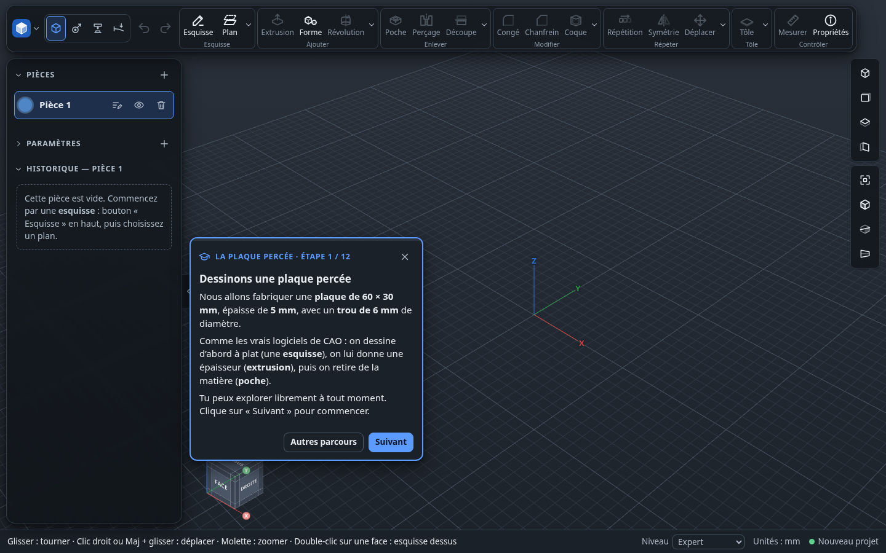
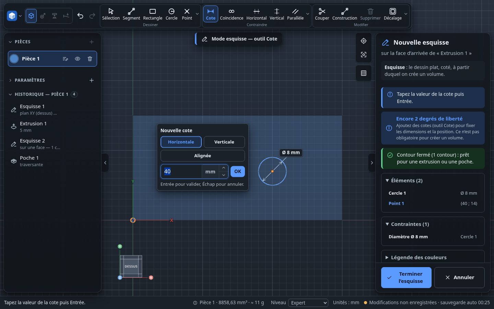
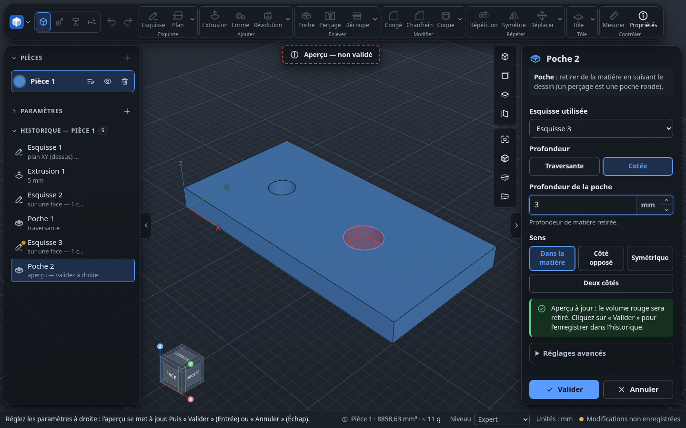
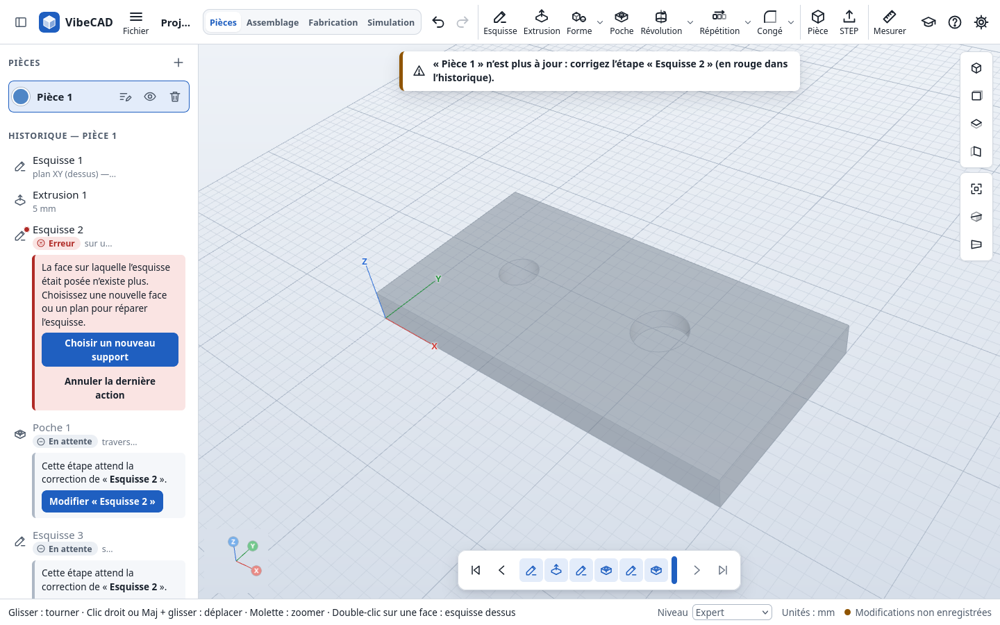

# Niveaux et parcours

VibeCAD suit la démarche de la CAO paramétrique (FreeCAD, Onshape, SolidWorks) : plan ou face,
esquisse cotée, extrusion, poche, modification d'une étape antérieure, échange STEP et STL. Ce
document décrit ce qui adapte l'interface : niveaux, bulles d'explication, assistant facultatif
et parcours guidés.

## Niveaux de l'interface

Pour que l'écran reste simple, VibeCAD a trois niveaux (en bas à droite, « Niveau », ou dans
l'Aide). Chaque niveau montre plus d'outils ; ceux d'un niveau supérieur sont masqués, pas
grisés.

| Niveau | Outils |
| --- | --- |
| **Débutant** | Esquisse : segment, rectangle, cercle, texte, cote, coïncidence, horizontal, vertical. Extrusion, poche, formes toutes faites (boîte, cylindre, boule), mesure. Impression 3D. Parcours « plaque percée ». |
| **Intermédiaire** | En plus : l'anneau, arc (par le centre ou par 3 points), rectangle centré, polygone, oblong, couper, projeter, construction, autres contraintes ; révolution, congé, chanfrein, coque, répétition, symétrie ; vue en coupe, centre de gravité ; onglet Assemblage ; découpe laser et documents ; parcours assemblage et fabrication. |
| **Expert** (par défaut) | En plus : lissage, balayage, « Garder » (intersection), découpe en deux, dépouille, extrusion jusqu'à une face, décalage de contour, ellipse et spline (esquisse), épaissir, import de fichiers STEP et STL (menu Fichier). |

À la **première ouverture** sur un ordinateur, une fenêtre propose de choisir le niveau (Expert
si on la ferme sans choisir). Le niveau est retenu sur l'ordinateur ; il se change aussi dans les
**Préférences** (menu Fichier), avec les bulles d'explication, le chat, le thème et l'aimantation à la grille. Pour l'imposer (formation, déploiement), un lien suffit, par
exemple `…/VibeCAD/?niveau=debutant` ou `?niveau=intermediaire`. Un projet fait à un niveau
supérieur s'ouvre toujours : ses étapes restent visibles et modifiables dans l'historique.

## Bulles d'explication

Au survol prolongé d'un outil (environ une demi-seconde), une bulle décrit l'outil et, s'il est indisponible, pourquoi. On peut les couper dans l'Aide (« Bulles
d'explication au survol des outils ») : on retrouve alors les info-bulles simples du navigateur.
Le réglage est retenu sur l'ordinateur.

## Assistant : Java

Java est un assistant facultatif, **désactivé par défaut** (ce n'est pas le logo de
l'application). On l'active dans Préférences › « Assistant » (ou dans l'Aide). Il présente alors
les étapes des parcours, illustre les bulles d'explication et signale les étapes en erreur avec un
bouton pour les corriger. Sans lui, les mêmes informations restent dans la barre d'état,
l'historique et les parcours.

## Le parcours guidé « plaque percée »

Bouton **Parcours** au bout de la barre (niveau Débutant), ou menu Fichier (logo) → Parcours guidés. Douze étapes courtes ;
chacune se valide toute seule en observant le modèle réel (« Étape validée »), et on peut
passer une étape, revenir en arrière ou quitter à tout moment. Le bouton à utiliser est mis en
évidence par un contour orange animé. Si l'assistant est activé, **Java** présente chaque étape.

En dehors du parcours, l'assistant n'apparaît que lorsqu'il a quelque chose d'utile à dire : une
étape en erreur (avec un bouton pour l'ouvrir ou la réparer), une esquisse au contour ouvert, une
pièce vide. Il ne modifie jamais la pièce lui-même. On peut le réduire d'un clic ou le masquer
(Aide → « Afficher le chat »).

| Étape | Action | Notion |
| --- | --- | --- |
| 1 | Esquisse → plan XY | un dessin se pose sur un plan |
| 2 | Rectangle depuis l'origine, tape 60, Tab, 30, Entrée | origine, cotes, saisie au clavier |
| 3 | Terminer l'esquisse | le dessin vert est entièrement contraint |
| 4 | Extrusion de 5 mm, Valider | aperçu puis validation |
| 5 | Double-clic sur le dessus de la plaque | dessiner sur une face |
| 6 | Cercle, tape 6 | diamètre |
| 7 | Cotes horizontale et verticale de 15 mm depuis l'origine | positionner par des cotes |
| 8 | Terminer l'esquisse | |
| 9 | Poche traversante, Valider | retirer de la matière |
| 10 | Double-clic sur « Esquisse 1 », cote 60 → 80 | modifier l'historique, recalcul |
| 11 | Enregistrer, exporter en STEP | enregistrement, échange |

Quand une étape ne peut plus se calculer (ici, la face qui portait une esquisse a disparu),
l'historique l'explique et propose de la réparer :

## Points d'attention connus

- Le clic doit tomber près de l'origine ou d'un axe pour s'y accrocher : le repère « Origine »,
  « Axe X » ou « Axe Y » s'affiche quand c'est le cas, et le point y reste lié. Alt maintenu
  désactive l'accrochage.
- Le double-clic sur une cote ouvre sa modification ; un simple clic la sélectionne.
- Échap annule l'outil en cours, puis revient à la sélection ; il ne ferme pas l'esquisse (pour
  éviter de perdre un dessin par erreur).
